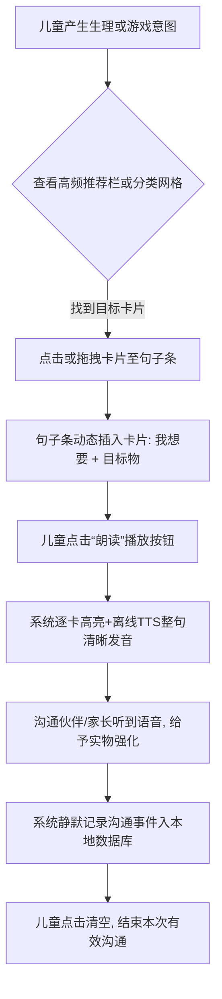
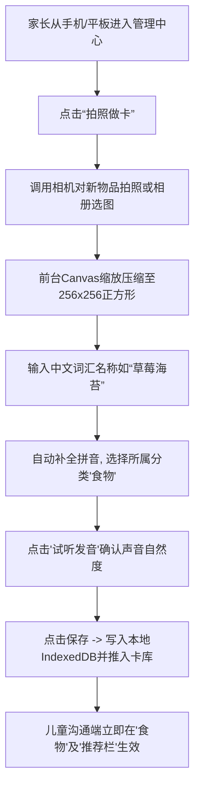

# 04 产品框架：系统架构、信息架构与交互设计

本项目在架构上兼顾“儿童沟通的极致纯粹”与“家长特教管理的严谨丰富”，采用“双模分离、数据互通、本地优先”的设计范式。

---

## 一、系统总体架构图

```
┌────────────────────────────────────────────────────────────────────────┐
│                        用户交互层 (Presentation Layer)                 │
├──────────────────────────────────┬─────────────────────────────────────┤
│       【儿童沟通端 (极简模式)】    │       【家长/特教管理端 (管理模式)】  │
│  • 标准化PECS句子条 (拖拽/点选)   │  • 智能儿童锁验证 (算术防误触)       │
│  • 智能情境感知高频卡片栏         │  • 拍照/上传/裁剪智能制卡模块        │
│  • 结构化卡片陈列网格 (大图+注音) │  • 卡片与分类全生命周期管理          │
│  • 多模态TTS发音与高亮联动动画    │  • 沟通行为日志追踪与多维可视化看板  │
│  • 句子条即时清空/回退控制        │  • 家长TTS语音可控调参与音色管理     │
│                                  │  • 离线数据包导入/导出与云备份       │
├──────────────────────────────────┴─────────────────────────────────────┤
│                        核心业务引擎层 (Core Business Layer)            │
├────────────────────────────────────────────────────────────────────────┤
│  • 句子条构建机 (Sentence Strip Engine): 语法约束校验与卡片状态机       │
│  • 情境推荐引擎 (Context Recommender): 基于场景标签+时间时段+衰减加权  │
│  • 多模态语音服务 (Audio Speech Engine): Web Speech API / 离线TTS封装  │
│  • 图像预处理流水线 (Image Processing Pipeline): 裁剪、压缩、缩略图生成│
│  • 行为记录与分析引擎 (Behavior Analytics Engine): 沟通潜伏期与事件量化 │
├────────────────────────────────────────────────────────────────────────┤
│                        持久化存储与基础设施层 (Data Layer)              │
├────────────────────────────────────────────────────────────────────────┤
│  • LocalStorage / IndexedDB (本地优先存储，零隐私泄露风险)             │
│  • 内置离线常用核心沟通词库 (Core Vocabulary Preset, 50+ 精选卡片)    │
│  • JSON 离线数据包引擎 (支持一键打包与跨设备迁移)                       │
│  • 微信小程序底层 API / 浏览器 PWA 离线 Service Worker                 │
└────────────────────────────────────────────────────────────────────────┘
```

---

## 二、产品信息架构（IA）

```
电子PECS沟通系统
├── [儿童沟通模式] (默认常驻首屏)
│   ├── 顶部操作栏
│   │   ├── 模式切换按钮 (点击触发儿童锁计算题进入家长端)
│   │   └── 当前情境指示与手动快选 (自动推荐 / 进餐 / 课堂 / 游戏 / 自理 / 情绪)
│   ├── 句子条 (Sentence Strip)
│   │   ├── 预设句首卡：【我想要 / 我要】(遵循Phase IV经典语法)
│   │   ├── 动态卡片放置槽 (支持左右滑移、长按拖拽、点击加入)
│   │   ├── 朗读按钮 (触发整句连贯发音，带高亮流转边框)
│   │   └── 清空/回退按钮 (方便清屏，重新发起沟通)
│   ├── 情境高频推荐卡槽 (水平滚动区，秒级访问当前情境Top卡片)
│   └── 核心卡片网格 (Card Grid)
│       ├── 分类标签过滤 (全部 / 食物饮料 / 玩具游戏 / 日常自理 / 动作动作 / 情绪心理 / 人物称呼)
│       └── 卡片元素 (高对比圆角卡片、生动实物/矢量图、规范中文、大字拼音、高亮触控反馈)
│
└── [家长与特教管理中心] (需密码解锁)
    ├── 1. 拍照做卡工坊 (Card Studio)
    │   ├── 实时拍照 / 本地相册选取
    │   ├── 智能正方形裁剪与压缩预览
    │   ├── 词汇名称录入 + 拼音自动匹配
    │   ├── 词性与分类归属标记 (名词/动词/修饰词/请求词)
    │   └── 声音试听与个性化录音配置
    ├── 2. 卡片库与分类管理 (Card & Category Manager)
    │   ├── 卡片列表过滤、隐藏、编辑、删除
    │   ├── 自定义新增/重命名生活分类
    │   └── 自定义卡片显示排序与优先级
    ├── 3. 沟通行为数据分析看板 (Behavior Analytics Dashboard)
    │   ├── 沟通频次趋势折线图 (日/周使用次数统计)
    │   ├── 高频词汇 TOP 5 柱状图
    │   ├── 情境场景分布环形占比图
    │   └── 详细沟通日志流水流水表 (时间戳、句子内容、所属场景、发音时长)
    ├── 4. 语音与安全控制配置 (Audio & Accessibility Settings)
    │   ├── TTS 语速调节滑块 (0.5x 慢速 至 1.5x 快速，专适听觉超敏儿童)
    │   ├── 音调与音量调节
    │   ├── 发音人选择 (自然童声、温柔女声、沉稳男声)
    │   ├── 自动时间感知情境开关
    │   └── 专业AAC免责与安全告知 (明确系统辅助定位)
    └── 5. 数据同步与离线卡包 (Backup & Sync)
        ├── 一键导出本地完整卡包与日志 (JSON格式文件下载)
        ├── 一键导入恢复离线卡包
        └── 恢复系统预置默认核心词库
```

---

## 三、核心交互业务流程图

### 1. 儿童“从需求到发音”闭环流程（遵循PECS Phase IV）


### 2. 家长随手拍照做卡流程


---

## 四、面向孤独症低龄儿童的专属设计规范与设计心理学

为杜绝传统APP因过度复杂的动画和装饰造成的**自闭症儿童感官超载（Sensory Overload）**与**刻板行为固化**，本项目制定了严苛的设计规范：

1. **色彩心理学与低饱和基底**：
   - 避免大面积使用高明度刺激红、亮黄或霓虹荧光色；采用柔和温润的米白背景（#F8FAFC）、低饱和自然青蓝（#38BDF8 / #0EA5E9）作为引导色，给予患儿安全平静的心理暗示。
2. **零杂质大触控热区**：
   - 卡片尺寸统一为 100px~120px 大尺寸方形卡，圆角 16px，触摸边距充裕，消除精细控制困难导致的误触烦躁。
3. **清晰的双通道注音设计**：
   - 采用标准规范楷体汉字，顶部配有标准声调拼音（Pinyin），对兼具文字敏感或处于学拼音阶段的患儿提供跨模态语言启蒙。
4. **即时正向多模态反馈**：
   - 卡片轻触时有柔和的微缩弹动反馈，拖入句子条时有柔和磁吸感；朗读时每个词卡对应轮流闪烁柔和蓝光外框，指引儿童建立“文字-发音-实物”的对应联结。
